# WEB404 Assignment 3: Secure File Upload

## 1. Introduction

Many websites let users upload files, such as profile pictures or documents. If the server does not check these files properly, an attacker can upload a harmful file instead of a normal one.

Common risks of an insecure file upload:

- **Remote code execution:** the attacker uploads a script (for example `shell.php`). If the server runs it, the attacker can run commands on the server.
- **Stored cross-site scripting (XSS):** the attacker uploads an `.html` or `.svg` file that contains JavaScript. The script runs in the browser of anyone who opens the file.
- **Server configuration change:** the attacker uploads a `.htaccess` file that changes how the web server treats other files.
- **Directory traversal:** the attacker uses a filename such as `../../server.js` to write outside the upload folder.
- **Denial of service:** the attacker uploads very large files, or many files quickly, to fill the disk or slow the server.
- **Information disclosure:** error messages reveal server paths and code details.

For this practical I built one web application with two upload features:

1. **Vulnerable upload** (`/vulnerable/upload`): written with common mistakes on purpose, so the attacks can be shown.
2. **Secure upload** (`/secure/upload`): uses several security checks that block the same attacks.

## 2. Objectives

1. Show how malicious file uploads work.
2. Validate file type and file content on the server.
3. Store and serve uploaded files safely.
4. Test both versions with the same attack files and compare the results.

## 3. Background

### 3.1 Why simple checks are not enough

| Check | Problem |
|-------|---------|
| `accept="image/*"` in the HTML form | It runs in the browser. Tools like curl or Burp Suite send the request directly and skip it. |
| `Content-Type` header from the client | The client sets this value, so it can be changed to anything (for example `image/png` for a PHP file). |
| Blocking only `.php` | There are other dangerous extensions: `.phtml`, `.php5`, `.phar`, `.PhP`. |
| Checking only the last extension | A file named `shell.php.jpg` can still run as PHP on a badly configured server. |
| Checking only the first bytes (magic bytes) | A **polyglot** file starts with a valid image header and has script code after it. |
| Keeping the original filename | The user controls the name, so they can use `../`, overwrite other files, or upload `.htaccess`. |

### 3.2 Defence in depth

No single check is enough. The secure version uses several checks one after another. If one check is bypassed, a later one can still stop the file.

```
Upload request
  -> rate limit (max 20 uploads per minute)
  -> size and request limits (max 2 MB, one file)
  -> filename checks
  -> allowed extensions only
  -> Content-Type must match the extension
  -> magic bytes must match the extension
  -> scan content for script code
  -> save with a random name, outside the public folder, not executable
  -> write to the security log

Download request
  -> id must be a valid UUID
  -> send with safe headers (download only, no script execution)
```

## 4. Project structure

```
WEB404_Assignment-3/
├── server.js                    # Starts the app, adds security headers and error handler
├── src/
│   ├── config.js                # Folders, size limit, allowed types, rate limit
│   ├── vulnerable.js            # Insecure upload (for demonstration only)
│   ├── secure.js                # Secure upload, file list and download
│   └── validators.js            # All file checks
├── public/                      # Web page (index.html, app.js, style.css)
│   └── uploads/                 # Vulnerable storage (inside the public folder)
├── storage/secure/              # Secure storage (outside the public folder)
├── logs/security.log            # Log of accepted and rejected uploads
├── samples/generate-samples.js  # Creates normal and malicious test files
├── scripts/reset.js             # Deletes uploads and logs
├── tests/run-tests.sh           # Automated tests (25 tests)
├── screenshots/                 # Evidence for this report
├── guide.md                     # Step-by-step commands
└── README.md                    # This report
```

## 5. Setup and running

```bash
npm install          # install packages
npm run samples      # create test files in samples/payloads/
npm run reset        # clear old uploads and logs
npm start            # start the server on http://localhost:3000
npm test             # in a second terminal: run all tests
```

All packages installed with no known vulnerabilities:

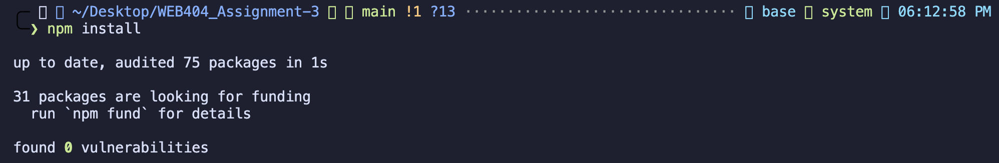

### 5.1 Test files

`npm run samples` creates 4 normal files and 9 malicious files:

| File | Type | Purpose |
|------|------|---------|
| valid.png, valid.jpg, valid.gif, valid.pdf | Normal | Should be accepted |
| shell.php | Malicious | PHP web shell that runs the `cmd` parameter as a system command |
| shell.php.jpg | Malicious | Same shell with a double extension |
| fake.png | Malicious | PHP code with a `.png` name |
| polyglot.gif | Malicious | Real GIF header (`GIF89a`) followed by PHP code |
| xss.html | Malicious | HTML page with JavaScript |
| xss.svg | Malicious | SVG image with JavaScript |
| .htaccess | Malicious | Apache rule that makes `.jpg` files run as PHP |
| malicious.pdf | Malicious | PDF with embedded JavaScript |
| large.jpg | Malicious | 3 MB file to test the size limit |

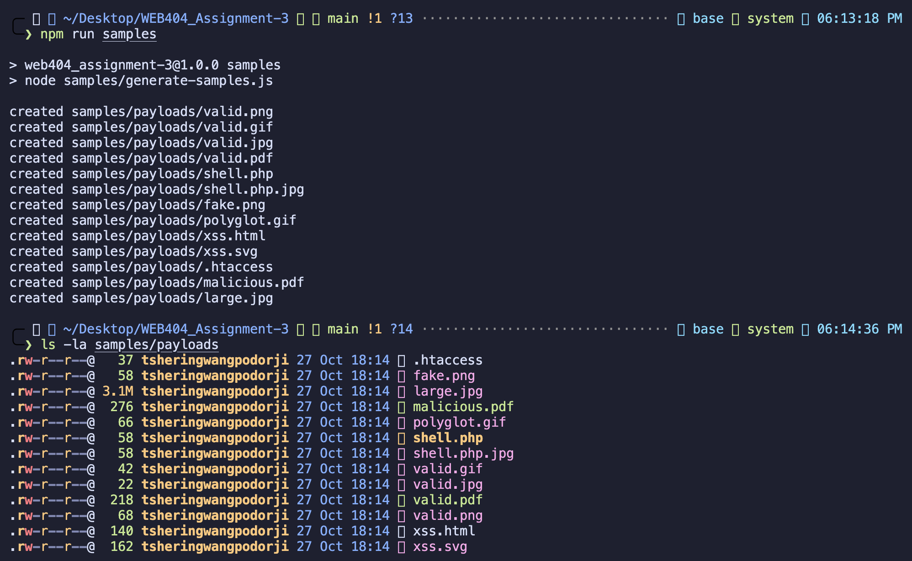

The PHP shell code, and a hex dump of the polyglot GIF. The dump shows that the file starts with `GIF89a` and has PHP code right after it:

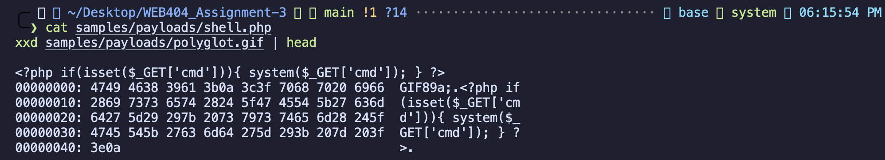

### 5.2 Running the server

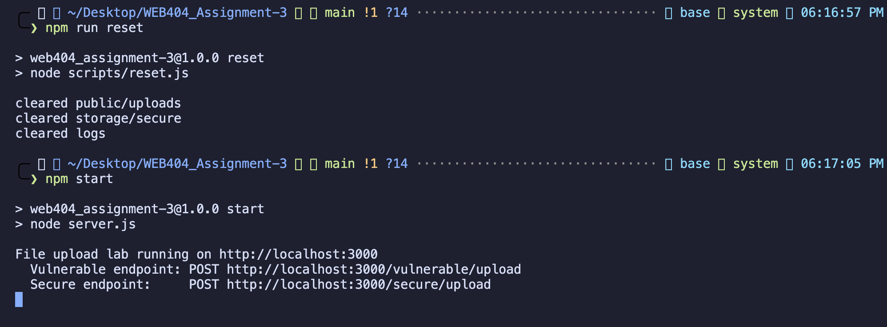

The web page has two panels: the red panel uses the vulnerable upload, and the green panel uses the secure upload.

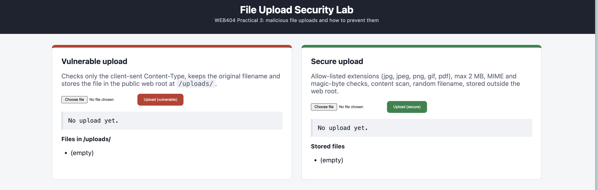

---

## 6. Vulnerable implementation

Code: [src/vulnerable.js](src/vulnerable.js)

```js
const storage = multer.diskStorage({
  destination: (req, file, cb) => cb(null, PUBLIC_UPLOAD_DIR),   // public folder
  filename: (req, file, cb) => cb(null, file.originalname),     // name chosen by user
});
const upload = multer({
  storage,
  fileFilter: (req, file, cb) => {                              // only checks client header
    if (file.mimetype.startsWith('image/') || file.mimetype === 'application/pdf') return cb(null, true);
    cb(new Error(`File type ${file.mimetype} not allowed`));
  },
});
```

The upload folder is also served directly by the web server ([server.js](server.js)):

```js
app.use('/uploads', express.static(PUBLIC_UPLOAD_DIR));
```

### 6.1 Weaknesses

| # | Weakness | Result |
|---|----------|--------|
| V1 | Only the client's `Content-Type` is checked | Any file is accepted if the header is changed |
| V2 | The original filename is kept | Dangerous extensions, double extensions and `.htaccess` are saved as-is |
| V3 | Files are saved in the public folder | Anyone can open them by URL; HTML and SVG files are shown as web pages |
| V4 | No size limit and no rate limit | Large files and floods are accepted |
| V5 | Error messages include the stack trace | Server folder paths and code files are revealed |

### 6.2 Attack results

**A1. Normal upload leaks the server path.** A normal PNG is accepted (HTTP 200). The response includes `storedAt`, which shows the full folder path on the server (`/Users/tsheringwangpodorji/Desktop/...`).

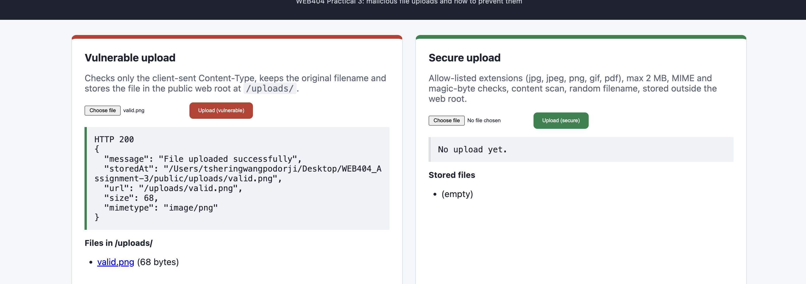

**A2. PHP web shell uploaded.** The `Content-Type` was set to `image/png` with curl. The server only checked this header, so it accepted `shell.php`.

```bash
curl -F "file=@samples/payloads/shell.php;type=image/png" http://localhost:3000/vulnerable/upload
```

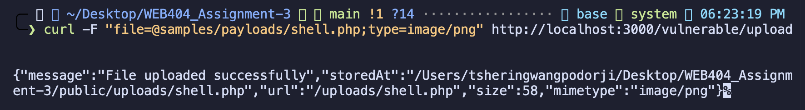

The shell is now in the public folder and anyone can request it at `/uploads/shell.php`. This server runs Node.js, so the PHP code is returned as text. On a server with PHP (for example Apache with PHP), `/uploads/shell.php?cmd=id` would run the `id` command on the server.

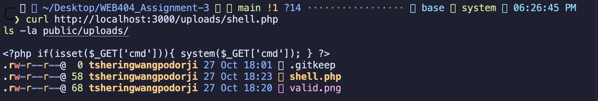

**A3. Stored XSS with an HTML file.** `xss.html` was uploaded with a fake `image/png` type and was accepted.

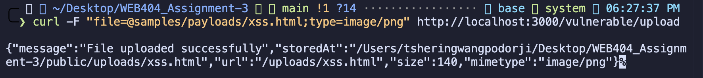

Opening `/uploads/xss.html` shows the "Hacked" page. The server sent the file as `text/html` from the application's own address (`localhost:3000`), so the browser treats it as a page of the site and runs its `<script>`. The screenshot was taken in the VS Code preview browser, which blocks `alert()` popups, so the alert box does not appear in it. In a normal browser the alert is shown.

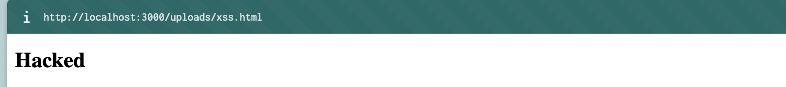

**A4. Stored XSS with an SVG file.** `xss.svg` was accepted, and opening it shows the "SVG XSS" image. The file was served as `image/svg+xml`, and SVG files can contain `<script>` tags that the browser runs. As with A3, the preview browser blocked the alert popup.

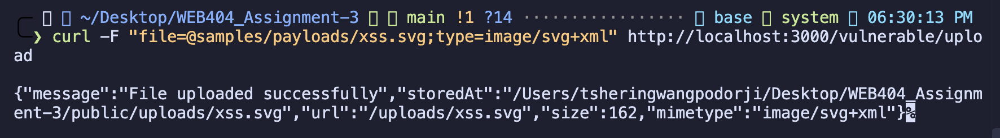
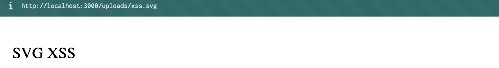

**A5. Double extension, .htaccess and a large file.** All three were accepted:
- `shell.php.jpg` (double extension)
- `.htaccess` (on Apache this would make every `.jpg` file run as PHP)
- `large.jpg` at 3,145,748 bytes (no size limit)

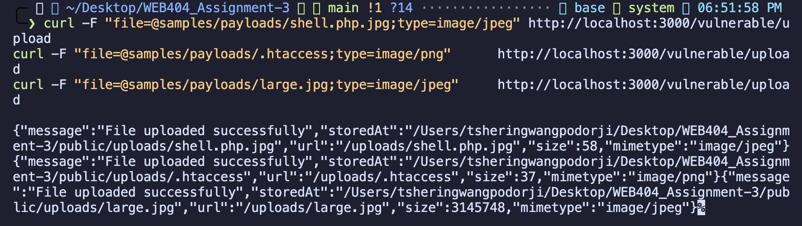

**A6. Information disclosure in errors.** When a file is rejected, the response includes the full stack trace. It shows the server's folder path, the file `src/vulnerable.js` and line 29, and the names of the libraries used (multer, busboy, streamsearch).

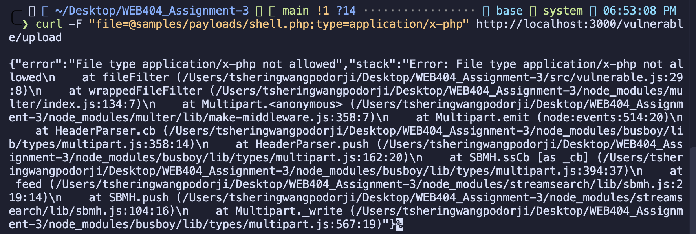

---

## 7. Secure implementation

Code: [src/secure.js](src/secure.js), [src/validators.js](src/validators.js), [src/config.js](src/config.js)

### S1. Rate limiting
Each IP address can upload at most 20 files per minute. After that, the server returns **HTTP 429** with a `Retry-After` header and logs a `RATE_LIMITED` event. This stops attackers from flooding the server.

### S2. Size and request limits
```js
limits: { fileSize: 2 * 1024 * 1024, files: 1, fields: 0, parts: 1 }
```
- Maximum file size is 2 MB. Larger files get **HTTP 413**.
- Only one file is allowed per request, and it must use the field name `file`.

### S3. Filename checks (`checkFilename`)
The filename is rejected if it:
- is empty or longer than 100 characters
- contains null bytes or control characters (for example `shell.php\0.jpg`)
- contains `/`, `\` or `..` (directory traversal)
- starts with a dot (`.htaccess`, `.user.ini`)
- has a dangerous extension **anywhere** in the name, not only at the end (`php`, `phtml`, `phar`, `jsp`, `asp`, `aspx`, `exe`, `sh`, `html`, `svg`, `js` and others). This blocks `shell.php.jpg`.

### S4. Allowed extensions only (`checkExtension`)
Only `.jpg`, `.jpeg`, `.png`, `.gif` and `.pdf` are allowed. Everything else is rejected. This is an **allow-list**: only known safe types are accepted, instead of trying to list every bad type.

### S5. Content-Type must match the extension (`checkDeclaredMime`)
Each extension has exactly one allowed `Content-Type`. For example, a `.jpg` file must be sent as `image/jpeg`. This check alone is not trusted, because the client controls the header, but it removes obviously wrong requests.

### S6. Magic bytes must match the extension (`checkMagicBytes`)
The server reads the first bytes of the file to find its real type:

| Type | First bytes |
|------|-------------|
| JPEG | `FF D8 FF` |
| PNG | `89 50 4E 47 0D 0A 1A 0A` |
| GIF | `GIF87a` or `GIF89a` |
| PDF | `%PDF-` |

The real type must match the extension. A text file named `fake.png` fails because it does not start with the PNG bytes.

### S7. Content scan (`checkContent`)
The whole file is searched for script code: `<?php`, `<script`, `<%@ page`, `runat="server"`, `eval(`, `system(`, `<html`, `<svg`. PDF files are also checked for `/JavaScript`, `/JS`, `/Launch`, `/OpenAction` and `/EmbeddedFile`. This catches polyglot files that pass the magic-byte check.

### S8. Check before saving
The file is kept in memory (`multer.memoryStorage()`) until all checks pass. A rejected file is never written to disk.

### S9. Safe storage
- The file is saved with a random name from `crypto.randomUUID()`, with no extension. The user cannot choose the name or path.
- Files are saved in `storage/secure/`, which is **outside** the public folder, so they cannot be opened directly by URL.
- File permissions are `0640` (`-rw-r-----`), so the file cannot be executed.
- The file is opened with the `wx` flag, so an existing file is never overwritten.
- A separate `.json` file stores the cleaned original name, detected type, size, SHA-256 hash and upload time.

### S10. Safe download
Files can only be read through `GET /secure/files/:id`:
- The `id` must be a valid UUID. Anything else (for example `..%2F..%2Fserver.js`) returns `Invalid file id`.
- `Content-Type` is the type detected at upload, not a guess based on the name.
- `Content-Disposition: attachment` makes the browser download the file instead of opening it.
- `X-Content-Type-Options: nosniff` stops the browser from guessing a different type.
- `Content-Security-Policy: default-src 'none'; sandbox` stops any script from running even if the file is opened.

### S11. Safe error messages
Errors never include stack traces or server paths. Validation errors return a short reason. Unexpected errors return `Upload failed` or `Internal server error`. The `X-Powered-By` header is turned off.

### S12. Security headers on the web page
Helmet adds headers such as `Content-Security-Policy` (`script-src 'self'`, `object-src 'none'`, `frame-ancestors 'none'`), `X-Content-Type-Options`, `X-Frame-Options` and `Referrer-Policy`. The page's JavaScript shows server data with `textContent`, not `innerHTML`, so a filename cannot inject HTML.

### S13. Security log
Every accepted, rejected and rate-limited upload is written to `logs/security.log` with the time, IP, event type, reason, filename and hash.

---

## 8. Test results for the secure upload

**Normal files are accepted.** The PNG and PDF return **HTTP 201**. Each file gets a random UUID, the type detected by the server, and a SHA-256 hash.

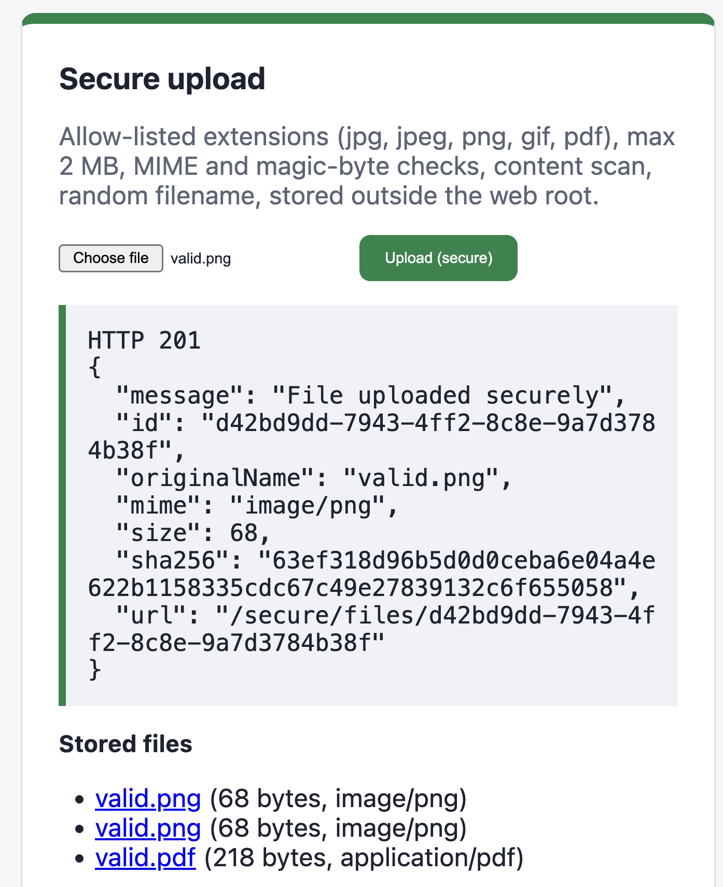
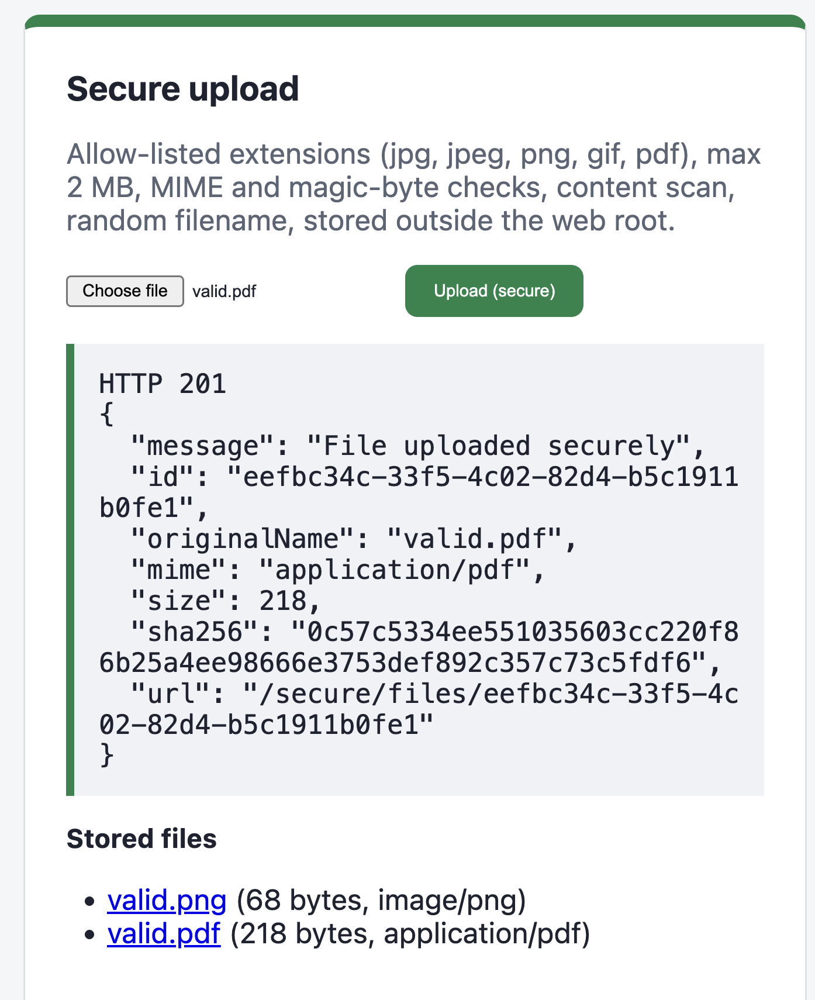

**All malicious files are rejected.** All ten attack files were sent at once. The responses are in this order: shell.php, shell.php.jpg, fake.png, polyglot.gif, xss.html, xss.svg, .htaccess, malicious.pdf, large.jpg, photo.jpg.

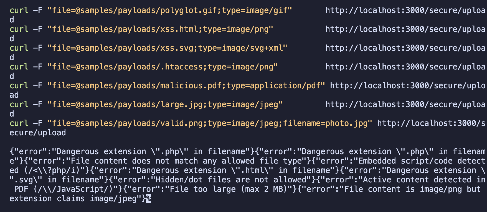

**Magic-byte check.** `fake.png` is rejected because its content is not a real image. A PNG renamed to `photo.jpg` is rejected because the content is PNG but the name says JPEG. Both return HTTP 400.

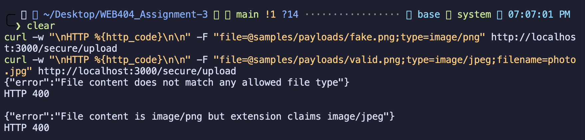

**Content scan.** `polyglot.gif` passes the magic-byte check, but is rejected because `<?php` was found inside it. `malicious.pdf` is rejected because it contains `/JavaScript`.

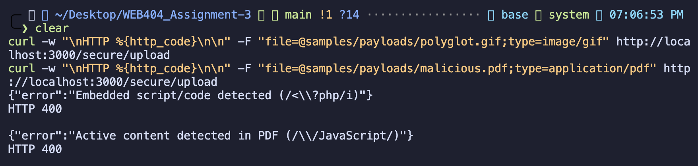

**Filename check.** `xss.html` and `xss.svg` are rejected for dangerous extensions. `.htaccess` is rejected as a hidden file.

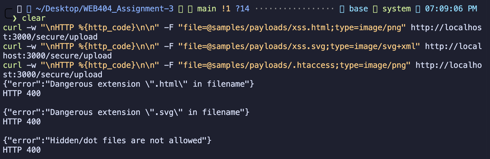

**Size limit.** `large.jpg` (3 MB) is rejected with **HTTP 413**.

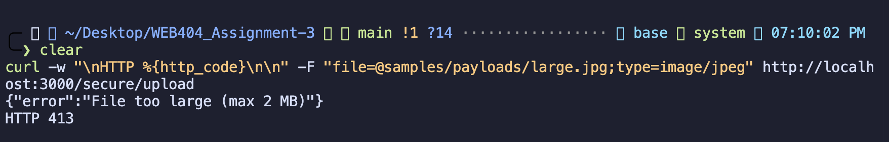

**Full response headers.** The complete list of headers sent with a stored file. Along with the file-specific headers, Helmet adds `Strict-Transport-Security`, `X-Frame-Options`, `Referrer-Policy` and `Cross-Origin-Resource-Policy`, and `Cache-Control: private, no-store` stops the file from being cached. The traversal attempt at the end returns `Invalid file id`.

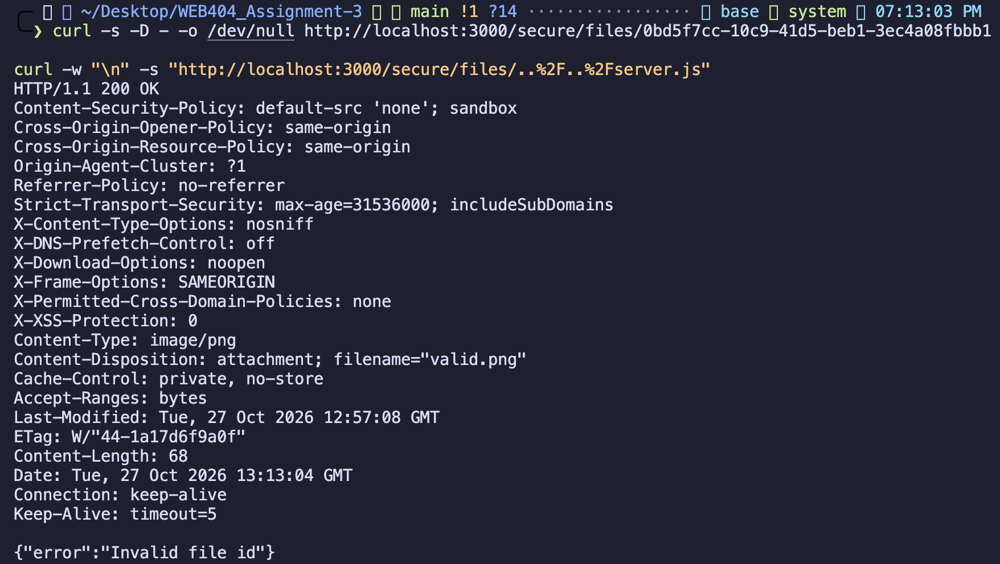

**Download headers.** The download returns `Content-Security-Policy: default-src 'none'; sandbox`, `X-Content-Type-Options: nosniff`, `Content-Type: image/png` and `Content-Disposition: attachment`. The traversal attempt `..%2F..%2Fserver.js` returns `Invalid file id`.

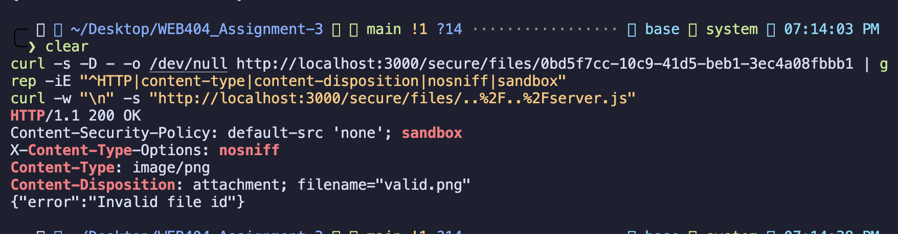

**Rate limit.** 25 uploads were sent in a loop. The first 20 returned **201** and the last 5 returned **429**.

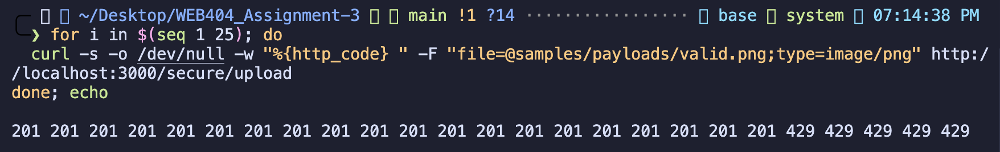

**Security log.** The log shows every event: `UPLOAD_ACCEPTED` with id and hash, `UPLOAD_REJECTED` with the stage (`request` or `content`), reason and filename, and `RATE_LIMITED` for requests 21 to 25.

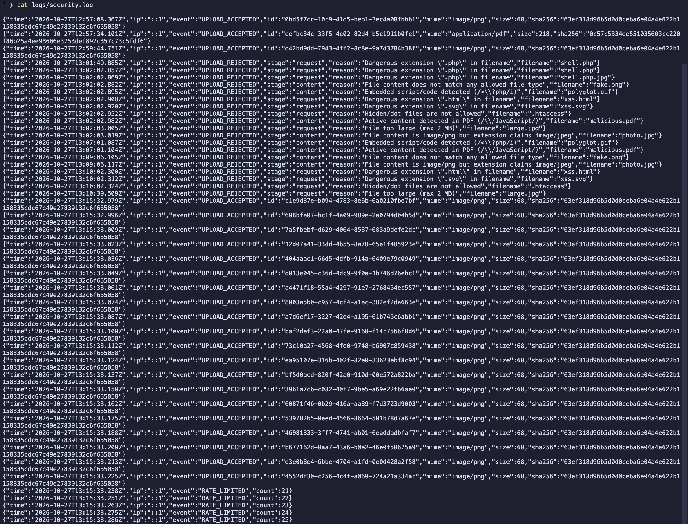

**Automated tests.** `npm test` runs all attacks against both endpoints. Result: **25 passed, 0 failed**.

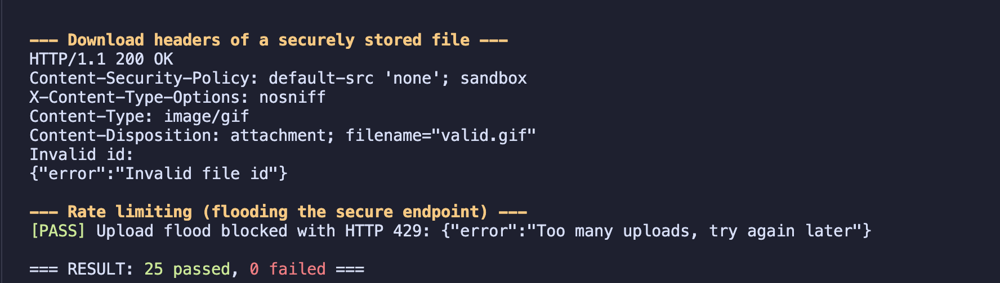

---

## 9. Comparison

| Attack file | Vulnerable upload | Secure upload | Blocked by |
|-------------|-------------------|---------------|-----------|
| valid.png / .jpg / .gif / .pdf | Accepted (200) | Accepted (201) | n/a |
| shell.php with fake `image/png` | **Accepted** | Rejected (400) | S3 filename |
| shell.php.jpg | **Accepted** | Rejected (400) | S3 filename |
| fake.png (PHP code) | not tested | Rejected (400) | S6 magic bytes |
| PNG content named photo.jpg | not tested | Rejected (400) | S6 magic bytes |
| polyglot.gif | not tested | Rejected (400) | S7 content scan |
| malicious.pdf | not tested | Rejected (400) | S7 content scan |
| xss.html | **Accepted**, served as web page | Rejected (400) | S3 filename |
| xss.svg | **Accepted**, served as web page | Rejected (400) | S3 filename |
| .htaccess | **Accepted** | Rejected (400) | S3 filename |
| large.jpg (3 MB) | **Accepted** | Rejected (413) | S2 size limit |
| 25 uploads in a row | All accepted | 20 accepted, then 429 | S1 rate limit |
| Rejected file error | Stack trace shown | Short reason only | S11 errors |
| `../../server.js` download | n/a | `Invalid file id` | S10 UUID check |

## 10. OWASP recommendations covered

| OWASP File Upload Cheat Sheet | Where |
|---|---|
| Allow only permitted extensions | S4 |
| Validate the file type; do not trust the Content-Type header | S5, S6 |
| Rename files with a name generated by the server | S9 |
| Limit filename length and characters | S3 |
| Set a file size limit | S2 |
| Store files outside the web root | S9 |
| Scan file content | S7 |
| Serve files with safe headers | S10 |
| Only allow authorised users to upload | Not done (no login in this lab) |
| Protect the upload form against CSRF | Not done (no sessions in this lab) |

## 11. Limitations and future work

- **Login and access control:** in a real application, only logged-in users should upload, and users should only see their own files.
- **CSRF protection:** add CSRF tokens or `SameSite` cookies once the application has sessions.
- **Image re-encoding:** re-saving images with a library such as `sharp` would remove hidden data and EXIF metadata. The content scan in this lab looks for known patterns and could miss hidden or encoded code.
- **Antivirus scan:** add ClamAV to detect known malware.
- **Rate limit storage:** the rate limiter keeps counts in memory, so it resets when the server restarts and does not work across several servers. A Redis-based limiter or a WAF would fix this.
- **Separate file domain:** serving user files from a different domain keeps them separate from the main site.
- **Storage quota:** limit the total storage per user.

## 12. Conclusion

The vulnerable upload showed that checking only the browser's `accept` attribute and the client's `Content-Type` header does not protect the server. It accepted a PHP web shell, HTML and SVG files with JavaScript, a `.htaccess` file, a double-extension file and a 3 MB file. Its error messages also revealed server paths and code details.

The secure upload used several layers of checks:
- rate and size limits
- filename rules
- an extension allow-list
- Content-Type and magic-byte checks
- a content scan
- random filenames in a non-public folder with no execute permission
- safe download headers
- short error messages
- a security log

It rejected all of the malicious files and still accepted the normal images and PDF. The automated test suite passed all 25 tests.

The main point of this practical is that no single check is enough. A secure upload needs to check the file, control where and how it is stored, and control how it is sent back to users.

## 13. References

1. OWASP File Upload Cheat Sheet: https://cheatsheetseries.owasp.org/cheatsheets/File_Upload_Cheat_Sheet.html
2. OWASP, Unrestricted File Upload: https://owasp.org/www-community/vulnerabilities/Unrestricted_File_Upload
3. PortSwigger Web Security Academy, File upload vulnerabilities: https://portswigger.net/web-security/file-upload
4. CWE-434, Unrestricted Upload of File with Dangerous Type: https://cwe.mitre.org/data/definitions/434.html
5. Multer documentation: https://github.com/expressjs/multer
6. Helmet documentation: https://helmetjs.github.io/

> ⚠️ The `/vulnerable` endpoint is insecure on purpose and is only for this lab. Do not deploy it.
